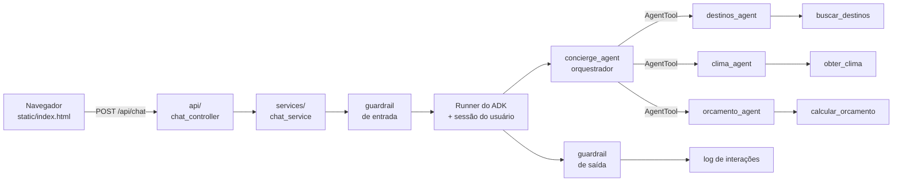

# Concierge de Viagens

Projeto de exemplo que mostra **como um sistema multiagente do Google ADK vira uma aplicação web de verdade**: um agente orquestrador recebe o pedido do usuário e aciona especialistas (destinos, clima e orçamento), tudo exposto por uma API FastAPI com interface de chat.

> Os dados de destinos e preços em `data/destinos.json` são **fictícios**, só para fins didáticos. A previsão do tempo vem da API pública [Open-Meteo](https://open-meteo.com/) (sem chave).

## Como rodar

Pré-requisito: ter feito o setup da raiz do repositório (`sh bootstrap.sh` ou `bootstrap.cmd`) e ativado o `.venv`. O `google-adk` já traz FastAPI e uvicorn, então não há mais nada para instalar.

```bash
cd concierge-viagens
cp .env.example .env          # Windows (cmd): copy .env.example .env
```

Edite o `.env` e coloque sua chave gratuita do [Google AI Studio](https://aistudio.google.com/apikey) em `GOOGLE_API_KEY`. Depois:

```bash
uvicorn main:app --reload
```

| Endereço | O que é |
|---|---|
| http://127.0.0.1:8000 | Interface de chat |
| http://127.0.0.1:8000/docs | Documentação interativa da API (Swagger) |

Para testar a API direto:

```bash
curl -X POST http://127.0.0.1:8000/api/chat \
  -H "Content-Type: application/json" \
  -d '{"user_id": "aluno-1", "message": "Quero uma praia quente com diária de até R$ 500"}'
```

## Arquitetura



### O caminho de uma mensagem

1. O navegador envia `POST /api/chat` com `user_id` e `message`.
2. O **guardrail de entrada** rejeita mensagens vazias, longas ou com tentativa de prompt injection, e mascara CPF e cartão.
3. O serviço recupera a **sessão** do usuário (ou cria a primeira), para a conversa manter contexto.
4. O **Runner** executa o agente raiz, que decide quais especialistas chamar. Cada especialista usa sua própria ferramenta.
5. O **guardrail de saída** saneia a resposta.
6. A interação é gravada em `logs/interactions.jsonl` (em segundo plano) e a resposta volta ao navegador, junto com a lista de especialistas acionados.

## Estrutura de pastas

```
concierge-viagens/
├── main.py                    # app FastAPI: rotas + arquivos estáticos
├── config.py                  # configurações da aplicação (.env)
├── agents/                    # TUDO que é do ADK (o "cérebro")
│   ├── agent.py               #   root_agent: o orquestrador
│   ├── root_prompt.py         #   instruções do orquestrador
│   ├── config.py              #   modelo usado pelos agentes
│   ├── tools.py               #   funções Python que viram ferramentas
│   └── subagents/
│       ├── destinos_agent.py  #   um arquivo por especialista
│       ├── clima_agent.py
│       ├── orcamento_agent.py
│       └── prompts.py         #   instruções dos especialistas
├── api/
│   └── chat_controller.py     # rotas HTTP (só recebe e devolve JSON)
├── models/
│   ├── requests/              # schemas de entrada (Pydantic)
│   └── responses/             # schemas de saída (Pydantic)
├── services/
│   ├── chat_service.py        # liga a API ao agente (Runner, sessão, eventos)
│   ├── guardrails.py          # proteção de entrada e saída
│   └── interaction_log.py     # auditoria das interações
├── utils/logging_config.py
├── data/destinos.json         # base fictícia
├── static/index.html          # interface de chat
├── .env.example
├── requirements.txt
└── Dockerfile
```

A regra por trás da organização: **o pacote `agents/` não sabe que existe uma web**, e a camada web não sabe como o agente raciocina. Dá para trocar um sem mexer no outro.

## Conceitos do ADK mostrados aqui

| Conceito | Onde ver |
|---|---|
| Agente com instrução e modelo | `agents/subagents/destinos_agent.py` |
| Função Python como ferramenta (docstring + type hints) | `agents/tools.py` |
| Orquestrador que usa agentes como ferramentas (`AgentTool`) | `agents/agent.py` |
| Prompts separados do código | `agents/root_prompt.py`, `agents/subagents/prompts.py` |
| `Runner` e eventos (`get_function_calls`, `is_final_response`) | `services/chat_service.py` |
| Sessão por usuário (`SessionService`) | `services/chat_service.py` |
| Guardrails e auditoria ao redor do agente | `services/guardrails.py`, `services/interaction_log.py` |

## Bônus: a mesma lógica no `adk web`

O ADK tem uma interface própria de desenvolvimento, ótima para depurar. Ela mostra o passo a passo de cada chamada (qual especialista, qual ferramenta, quais argumentos). Dentro de `concierge-viagens/`:

```bash
adk web .
```

Abra o endereço indicado e escolha `agents`. Compare com o chat: é o **mesmo agente**, mas aqui você enxerga o raciocínio por dentro. Use o `adk web` para desenvolver e a API FastAPI para entregar o produto.

## Desafios para os alunos

1. **Novo especialista:** crie um `hospedagem_agent` com uma ferramenta que liste hotéis de `data/` e registre-o no orquestrador. Lembre de adicionar o nome em `SPECIALIST_LABELS` no `index.html`.
2. **Ferramenta nova:** faça `buscar_destinos` aceitar também o campo `melhor_epoca` como filtro.
3. **Guardrail:** adicione um padrão novo em `services/guardrails.py` e escreva um teste que prove que ele funciona.
4. **Persistência:** troque o `InMemorySessionService` por um que sobreviva ao reinício do servidor (veja a documentação do ADK sobre `DatabaseSessionService`).
5. **Streaming:** transforme `/api/chat` em uma resposta que chegue aos poucos (Server-Sent Events).
6. **Troca de modelo:** mude a variável `MODEL` no `.env` e compare a qualidade e a velocidade das respostas.

## Problemas comuns

**A resposta é "Tive um problema para responder agora"**
Quase sempre é a chave de API: confirme que o `.env` existe (dentro de `concierge-viagens/`) e que `GOOGLE_API_KEY` está preenchida. O motivo exato aparece no terminal onde o `uvicorn` está rodando e em `logs/interactions.jsonl`.

**`ModuleNotFoundError: No module named 'agents'`**
Rode o `uvicorn` de dentro da pasta `concierge-viagens/`, não da raiz do repositório.

**`uvicorn: command not found`**
O ambiente virtual não está ativado. Veja o passo 3 do README da raiz.

## Docker (opcional)

```bash
docker build -t concierge-viagens .
docker run -p 8000:8000 --env-file .env concierge-viagens
```
